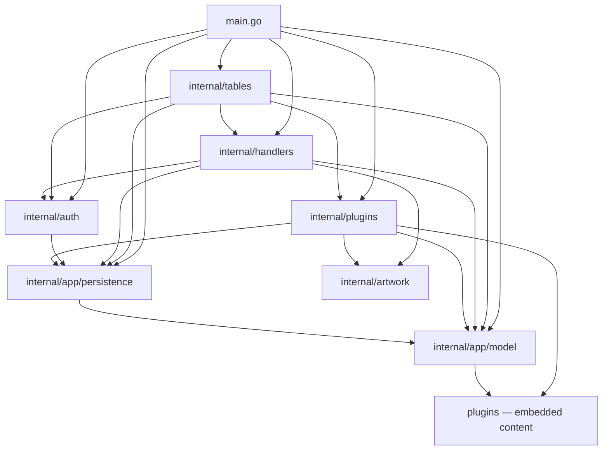
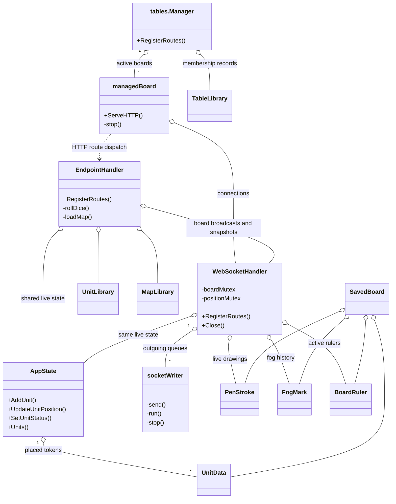
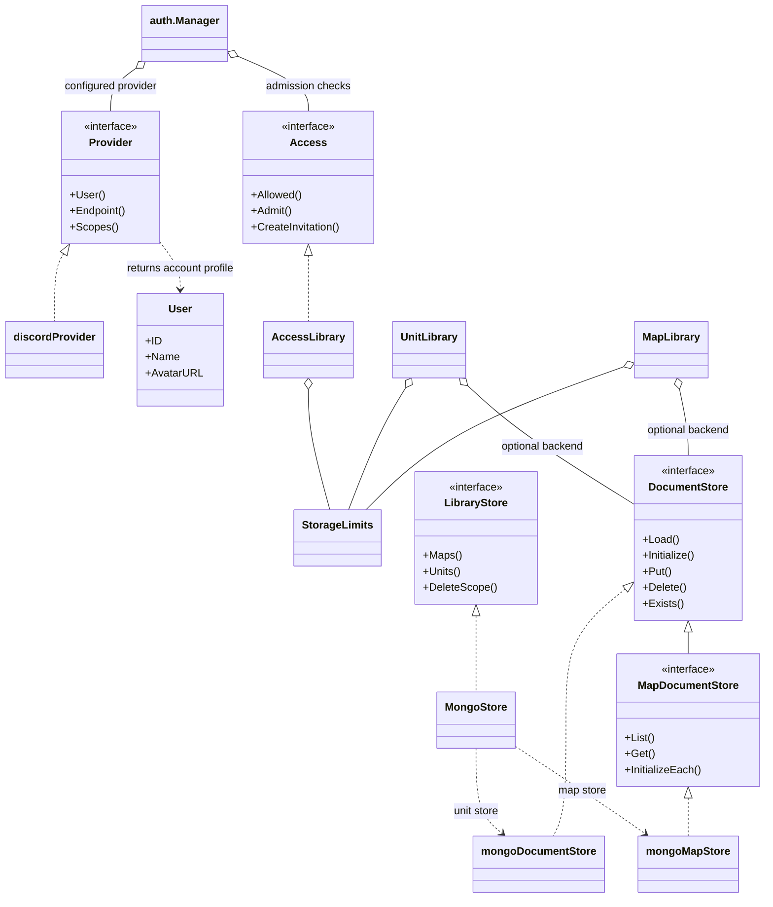
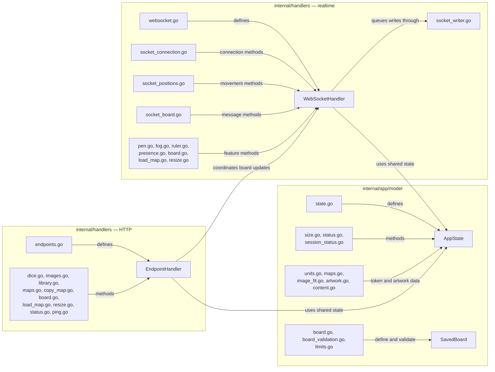

# Go architecture diagrams

These diagrams describe the current package imports, main structs/interfaces,
and ownership of the Go files. Go uses structs and interfaces; the class diagram
shows their relationships. Arrows in the package diagram mean “imports.”

## Package dependencies

This graph includes every application package and its direct imports of other
application packages. Standard-library dependencies, third-party dependencies,
and test-only imports are omitted. Root `plugins` holds embedded content;
`internal/plugins` loads and validates content.

## Main structs and interfaces

The two diagrams separate board handling from authentication and storage so the
relationships remain readable. An open diamond means a struct holds a reference
or collection. A dashed arrow to an interface means the type implements it.

`DocumentStore` is generic in Go; its type parameter is omitted here. With no
MongoDB backend, the libraries use local JSON files. Artwork stays in local
files for both configurations. Live drawings belong to `WebSocketHandler`,
while `AppState` holds placed tokens and status definitions. `SavedBoard` is the
snapshot used to persist both kinds of content.

## Go file ownership

This graph shows where methods for the main board types live. Arrows mean
“defines the type” or “contains methods for that type,” as labeled. The grouped
file lists cover related production code rather than individual test files.

Some files contain methods on multiple types. For example, `board.go` handles
the HTTP clear request and the socket-owned state reset. Keeping these methods
in the same package currently lets them share the board lock.

## Source entry points

| Area | Start here |
| --- | --- |
| Startup and route wiring | [main.go](../main.go) |
| Tabletop manager and board lifecycle | [tables.go](../internal/tables/tables.go), [board.go](../internal/tables/board.go) |
| HTTP board handler | [endpoints.go](../internal/handlers/endpoints.go) |
| Realtime handler | [websocket.go](../internal/handlers/websocket.go), [socket_board.go](../internal/handlers/socket_board.go) |
| Live token state | [state.go](../internal/app/model/state.go) |
| Saved board data | [board.go](../internal/app/model/board.go) |
| Unit and map libraries | [library.go](../internal/app/persistence/library.go), [maps.go](../internal/app/persistence/maps.go) |
| Storage interfaces and MongoDB | [document_store.go](../internal/app/persistence/document_store.go), [mongo.go](../internal/app/persistence/mongo.go) |
| Accounts and provider interface | [auth.go](../internal/auth/auth.go), [provider.go](../internal/auth/provider.go) |
| Invitations and admission | [access.go](../internal/app/persistence/access.go) |

The package graph can be checked against `go list -json ./...`: compare each
package's `Imports` entries beginning with `tableTop/main`. Update the struct
and file diagrams when moving a type or changing which component holds its
state. See [architecture guidance](architecture.md) for responsibilities and
rules for further extraction.
