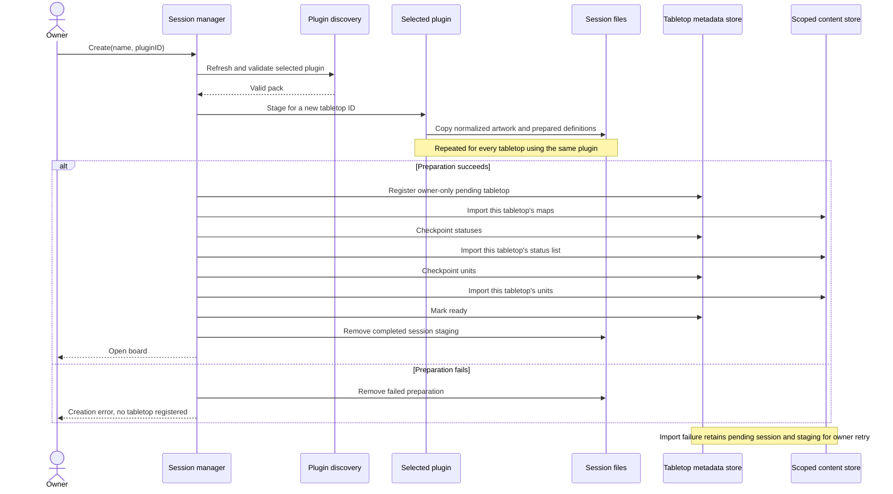
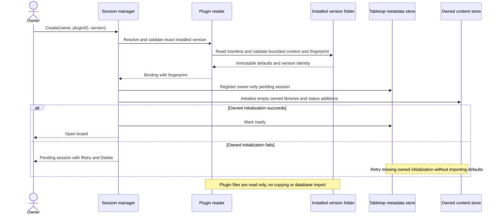
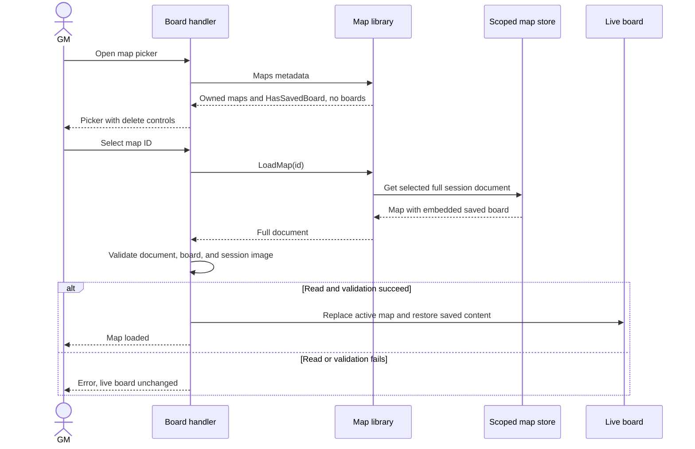
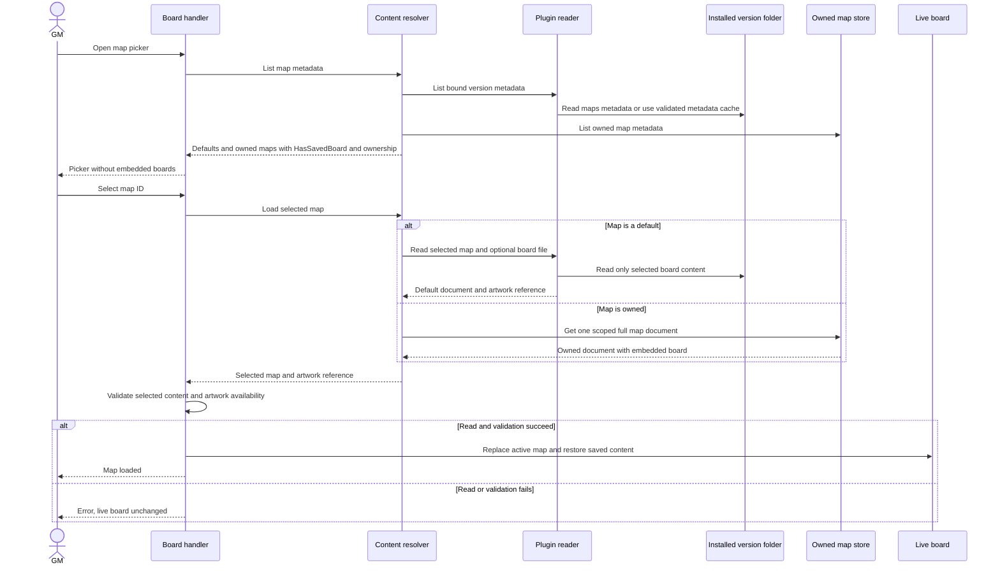
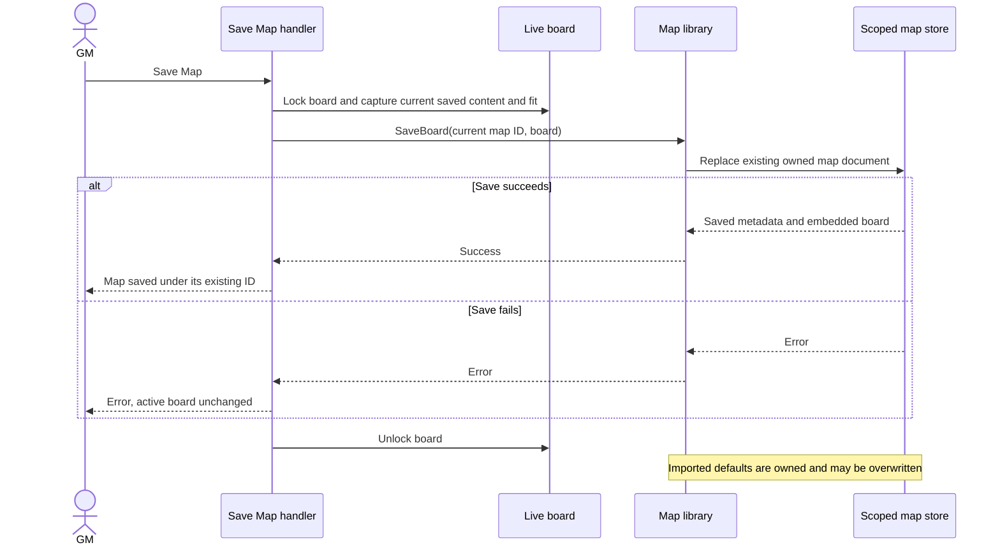
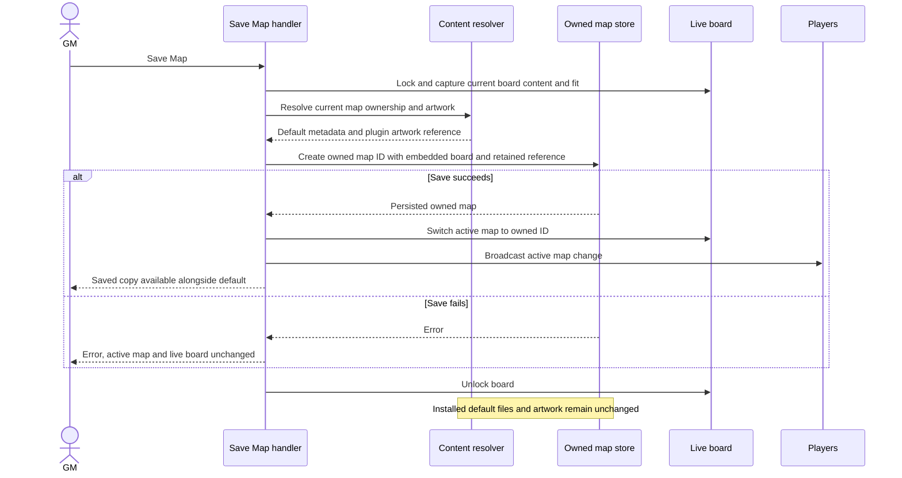
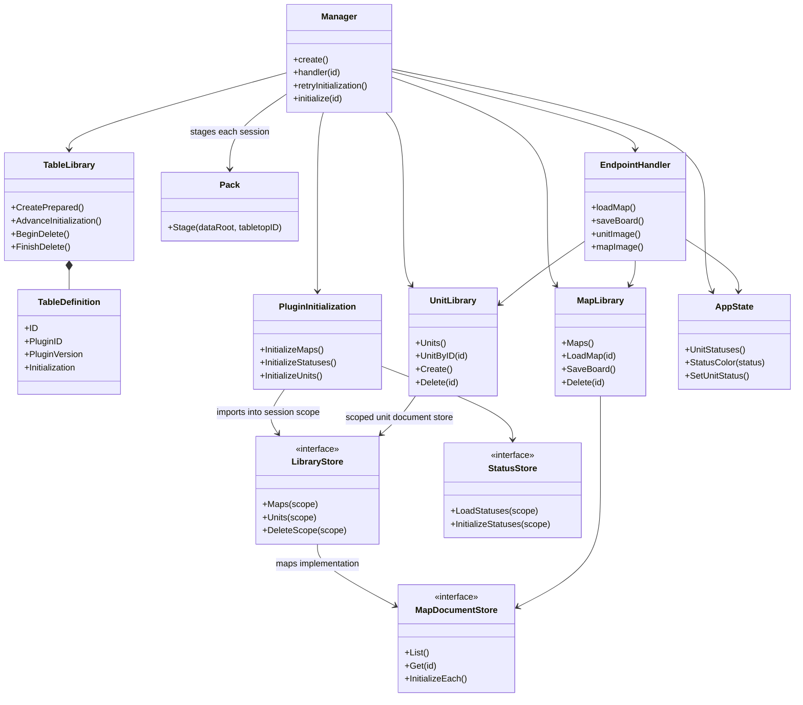
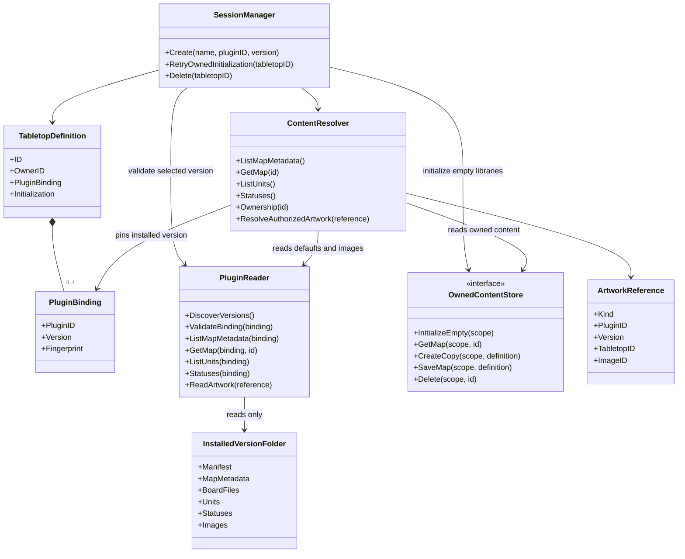

# Versioned plugin folders and tabletop-owned content

Status: implemented direct-folder model, replacing per-tabletop plugin imports.
Defaults are read directly from
retained, read-only plugin folders. There is no shared plugin import into MongoDB
or application data. The legacy diagrams describe the previous implementation.

## Decisions and comparison terminology

**Legacy** in the comparisons means the per-tabletop import implementation
currently in the workspace. **Proposed** labels the replacement direct-folder design implemented from this
specification. Pre-plugin saved data is identified separately in compatibility.
Diagram boxes describe Go structs, interfaces, and responsibilities represented
by package-level functions.

- Each new tabletop selects one installed plugin version and retains a binding
  to it. Store only additions, editable copies, and assigned statuses in its
  owned documents.
- Plugin defaults cannot be edited, deleted, or hidden. Copies have separate IDs
  and appear alongside their defaults; no deletion markers or shadowing rules.
- Copies reuse their plugin image until the user uploads a replacement.
- Changing a placed token changes that live instance, not its reusable default.
- Installed version folders are the durable source of defaults. Operators must
  retain them unchanged while any tabletop or saved artwork reference uses them.
- Existing saved data and previous pending imports are outside this implementation.
  Start with new bound tabletops; no migration or old import recovery is required.

This replaces the earlier shared-import proposal: remove the proposed importer,
shared MongoDB scope, version publication markers, plugin staging, shared import
checkpoints, and automatic retention inside `data/`. Plugin installation and
retention are deployment responsibilities. No app-managed plugin installation,
upgrades, combining plugins, executable hooks, marketplace, unit pagination, or
automatic cleanup of plugin folders is included in v1.

## Comparisons with the legacy implementation

### Plugin structure, discovery, and identity

| Area | Legacy: per-tabletop imports | Proposed: direct version folders |
| --- | --- | --- |
| Selected plugin | One plugin per tabletop | Unchanged, with an explicit selected version |
| Layout | `plugins/pluginID/plugin.json` and content files | `plugins/pluginID/version/plugin.json` and immutable version-local content |
| Manifest | Schema 1, separate maps/units/statuses lists, optional embedded map boards | Schema 2, separate lists, optional referenced board files so listings contain metadata only |
| Discovery | Refresh on lobby refresh, then revalidate selection | Unchanged, discover exact `(pluginID, version)` identities |
| Multiple installed versions | Duplicate plugin IDs are unavailable | Different versions of one ID coexist; duplicate ID/version pairs are unavailable |
| Built-in and additional packs | Bundled defaults plus read-only operator directories | Unchanged, using the versioned layout |
| Source identity | ID/version is provenance for copied content | ID/version identifies a retained folder; binding includes a content fingerprint |
| Editing the same version | New sessions can copy new contents while existing copies survive | Unsupported; fingerprint mismatch blocks use until the original is restored |
| Entry IDs | Stable IDs derived from plugin ID, kind, and key | Unchanged; binding identifies the version |
| Default ownership | Defaults become owned documents | Defaults remain read-only files |
| Default deletion | Allowed per tabletop | Forbidden server-side and absent from picker controls |
| Default editing | Imported map documents can be updated; no general unit editor exists | Create an owned copy; original remains available |
| Provenance | Describes the source of an owned imported item | Still descriptive; resolved source determines ownership |
| Live token changes | Separate from reusable definitions | Unchanged |

### Storage, creation, and recovery

| Area | Legacy: per-tabletop imports | Proposed: direct version folders |
| --- | --- | --- |
| Import frequency | Copy and import defaults for every tabletop | No import of defaults, either per-tabletop or shared |
| MongoDB defaults | Maps, units, and complete statuses written to session scope | No plugin default documents; MongoDB stores owned additions/copies/status additions |
| Plugin artwork | Custom images copied and normalized into every session | Read images from the retained version folder; no creation-time image writes |
| Version metadata | Session provenance and import step | Binding in session metadata; manifest and content remain in the folder |
| Preparation | Durable per-session `.plugin` staging | None for new sessions; validate installed files before registration |
| New-session initialization | Maps → statuses → units → ready | Initialize empty owned persistence, then mark session ready |
| Retry | Resume staged per-session import | Retry only owned session initialization; no plugin import phases |
| Pending access | Owner-only Retry/Delete, no join or board access | Unchanged for failed owned initialization |
| Concurrent creation | Separate imports, manager serializes initialization/deletion | Read the same immutable files, with existing session creation/deletion coordination |
| Removing a folder | Copies preserve ready sessions; staged copies support retries | Bound sessions depend on it; operator must retain or restore the exact version |
| Empty owned library | Never reinstall deleted defaults | Defaults resolve from the binding; empty owned content remains empty |
| Shared map persistence | None, maps live in session scope | `maps.json` contains metadata and optional board file paths; board files read on selection |
| JSON/MongoDB parity | Same scoped libraries in both modes | Same plugin file reader in both modes; only owned persistence differs |

### Reads, changes, statuses, and APIs

| Area | Legacy: per-tabletop imports | Proposed: direct version folders |
| --- | --- | --- |
| Listing | Session-owned entries | Combine read-only plugin metadata with owned entries |
| Picker | Owned delete controls | Default labels, Create copy, owned delete controls |
| Board loading | Read the selected full owned document on demand | Preserve lazy loading; read a default's board file or one owned document |
| Selection failure | Preserve current board | Unchanged; missing or modified version is an additional error |
| Save Map | Replace the current owned map under its ID | Default save creates an owned ID; later saves update that copy |
| Images | Bundled or session-local `imageID` | Plugin-version artwork reference alongside built-in and local image IDs |
| Image processing | Normalize uploads and imported images | Normalize uploads as before; normalize plugin image responses on demand without persisting copies |
| Copy behavior | No explicit default-copy routes | New map/unit copy routes; copies retain image reference and provenance |
| Image routes | Session-authorized local/built-in resolution | Keep routes and authorization, resolve plugin images internally |
| Status definitions | Complete ordered list per tabletop | Version folder's defaults plus persisted tabletop additions |
| Status limits | 1–256 unique definitions | Combined defaults/additions satisfy the same limit; additions cannot replace default names |
| Status editing | Stored list may differ from source; no management UI | Default names/colors immutable, additions owned; no new management UI |
| Assignment and rendering | Definitions on session state; assignments saved with tokens | Unchanged, resolver supplies the effective definitions |
| Unknown saved status | Preserve value with transparent color | Unchanged |
| Interfaces | Scoped libraries and document stores | Add a file-backed PluginReader and ContentResolver; no importer or shared version DB store |
| Mutation authority | Resolved session scope | Only owned scope may be written or deleted; copy is the way to customize a default |

### Limits, lifecycle, backups, and compatibility

| Area | Legacy: per-tabletop imports | Proposed: direct version folders |
| --- | --- | --- |
| File/image/board limits | Existing validation, configurable parser bounds, no map/unit counts | Retained; BSON limit applies when content becomes an owned MongoDB document |
| Global file quota | Includes all session copies and staging | Counts owned application data, not external or bundled read-only plugin folders |
| Session quota | Includes copied plugin files | Counts owned files only; plugin references consume no session artwork bytes |
| Operator disk capacity | Manage source plugin disk separately | Same responsibility, now source folders must also be retained for runtime use |
| MongoDB bytes | Outside file quotas | Unchanged |
| Delete tabletop | Delete scoped content, copied images, statuses, markers, staging | Delete owned data and binding, never touch installed plugins |
| Pending deletion | Remove that session's staged import | Remove owned initialization state only; remove old import recovery |
| Plugin folder removal | Does not affect copied sessions | Manual deployment operation; do not remove referenced versions |
| Backup | Matched MongoDB and data directory suffice | Also preserve all referenced exact plugin folders, including mounted and formerly bundled versions |
| Missing dependency | Fail for missing documents/images | Also fail clearly for missing or changed plugin folders; no fallback to latest |
| Pre-plugin data | Preserve owned content and migrate scoped statuses once | Out of scope, no migration required |
| Ready copied-plugin sessions | All imported entries owned | Out of scope, create new bound tabletops |
| Legacy pending sessions | Resume maps/statuses/units from session staging | Remove the old recovery path, new sessions initialize owned persistence only |
| Restart persistence | Live board resets, explicit Save Map persists, no shutdown save | Unchanged |
| Excluded features | No merging, executable hooks, automatic upgrades, or pagination | Unchanged, no app-managed plugin install/import/retention service |

## Versioned plugin layout and manifest

```text
plugins/
  builtin/
    1/
      plugin.json
      maps.json
      units.json
      statuses.json
  fantasy/
    1/
      plugin.json
      maps.json
      units.json
      statuses.json
      maps/forest.png
      boards/forest.json
      units/goblin.png
    2/
      plugin.json
      maps.json
      units.json
      statuses.json
```

Plugin ID/version must agree with their directory names. A version is a positive
integer. Authors install a new folder when changing a pack and keep older folders
while referenced. Treat each version directory as read-only after installation;
publish a complete directory before exposing it to discovery. The application
never writes into it. Bundled versions follow the same layout; operators preserve
older required versions across application image upgrades, using read-only mounts
when necessary. `TABLETOP_PLUGIN_DIRS` supplies additional discovery roots.

Example `plugin.json`:

```json
{
  "schemaVersion": 2,
  "id": "fantasy",
  "version": 1,
  "name": "Fantasy",
  "description": "Maps, creatures, and conditions.",
  "maps": "maps.json",
  "units": "units.json",
  "statuses": "statuses.json"
}
```

Example `maps.json` entry:

```json
[
  {
    "key": "forest",
    "name": "Forest",
    "image": "maps/forest.png",
    "width": 20,
    "height": 20,
    "offsetX": 0,
    "offsetY": 0,
    "boardFile": "boards/forest.json"
  }
]
```

`boardFile` is optional. If present, it references one JSON SavedBoard object
using the existing units/strokes/fog/rulers shape. Saved token image references
may use unit keys from this version, resolved to version-local artwork or built-in
fallbacks. Units and statuses retain their current list formats and validation.
Required map artwork and optional unit artwork remain version-relative paths.
An absent board starts empty; owned saved maps still embed their board in the
map document. This packaging change applies to schema 2 defaults only.

Discovery refreshes on lobby refresh. Offer available versions with a human name
and version label; the submitted selection identifies ID and version, not ID
alone. Initially select the shipped built-in version. Different versions of an
ID are valid; duplicate exact identities across roots make that identity
unavailable. Never pick a different version because the selected one vanished.
Schema 1 packs must be repackaged to be selectable in this new model. The old
per-session import and recovery path is removed.

Retain `TABLETOP_PLUGIN_METADATA_LIMIT_BYTES` (default 1 MiB) and
`TABLETOP_PLUGIN_CONTENT_LIMIT_BYTES` (default 16 MiB per list or board file).
Check names, unique keys, statuses, board limits, image formats/dimensions/bytes,
and all references. Reject absolute paths, traversal, non-regular files, and
symlinks escaping the version directory. Allow PNG, JPEG, and GIF within the
existing map/unit image bounds. Plugin image responses use the existing bounded
normalizer to produce PNG, including the first GIF frame. Do not write normalized
images into the plugin or session folder just to serve defaults.

Validation may scan board files one at a time to accept a version without keeping
boards in memory. Runtime listings use only `maps.json` metadata; image requests
read only image metadata and image files. No map/unit count caps are introduced.

## Binding, reads, and owned persistence

Persist optional `pluginBinding` in the tabletop definition containing plugin ID,
version, and a SHA-256 fingerprint of the manifest, content files, board files,
and referenced original artwork in deterministic path order. Plugin provenance
alone does not create a binding. A missing binding cannot be opened as a new-model tabletop; create a new one.

`PluginReader` indexes version folders and can cache validated metadata by exact
identity/fingerprint. Caches are an optimization, never a persistent content
store; restart rebuilds them from the installed folders. Verify fingerprints
when a version is first opened, on discovery refresh, and before binding a new
session. Invalidate cached metadata when a source change is detected. Revalidate
an uncached read or changed file against the bound version before using it.
This relies on the operator's immutable-folder contract rather than attempting
to make externally modified folders safe through a retention service.

A missing folder or fingerprint mismatch blocks new creation and dependent
content access with a clear error. Do not use another version or create owned
copies as an automatic repair. Preserve an already loaded live board on a failed
read and restore the exact folder to recover after restart. Unlike the earlier
shared-import proposal, existing sessions cannot keep reading a removed version.

Keep stable entry IDs derived from plugin ID, kind, and key. A resolver combines
that version's default metadata with session-owned entries and labels ownership.
Default and copy remain separate entries. Saved maps are read on selection,
from a referenced default board file or one owned map document, and validated
before replacing live content. The same PluginReader is used with MongoDB and
JSON; it performs no database writes for defaults.

| Content | Location and ownership |
| --- | --- |
| Default maps and boards | Version folder metadata and optional board files, read-only |
| Default units and status definitions | Version folder list files, read-only |
| Default images | Version folder original artwork, read-only |
| Binding and session readiness | Existing sessions metadata file |
| Owned map/unit additions and copies | Existing scoped MongoDB documents or session JSON files |
| Owned status additions | Scoped status document explicitly marked as additions; empty is valid for additions |
| Uploaded replacement images | Session-local images/maps directories |

Artwork references distinguish built-in, plugin-version, and session-owned
images. A plugin reference contains ID, version, and image ID. Saved tokens and
owned definitions retain the reference when using shared art. Built-in and local artwork continue to resolve through their image IDs. Resolve image requests through the authorized session and
its binding; never expose arbitrary installed plugin assets or filesystem paths.
Copy provenance and current artwork ownership are independent.

## Session creation and recovery

Resolve and validate the selected installed version before registering a session.
No source copying, durable plugin preparation, shared publication, or maps/statuses/
units import happens for a new session. Persist the binding and an owner-only
pending session, initialize empty owned map/unit libraries and status additions
idempotently, then mark it ready. The explicit initialized state prevents any
fallback constructor from seeding built-in owned defaults into an empty library.

Use a single `owned` initialization state for new bound sessions. If initialization
fails, retain owner-only Retry/Delete controls and block joining/board access.
Retry initializes only missing owned persistence, preserving documents already
written by previous attempts, then marks the session ready. A missing/changed
plugin during retry is an error; restoring its exact folder allows retry.
Creation and deletion remain coordinated to prevent publishing a deleted session.
Concurrent creators read the same immutable version without an import lock.
A failure before registration creates no session; a failed registration has no
plugin staging or copied assets to clean up.

### Legacy sequence: create a tabletop with copied defaults



**Change:** replace per-session staging and three import phases with validation,
a binding, and empty owned-library initialization. No new shared import service
or version publication phases replace them.

### Proposed sequence: create a tabletop referencing an installed version



## Reading and modifying content

List shared defaults alongside owned entries. Label defaults and offer Create
copy instead of delete/edit controls. Verify ownership server-side on every
mutation. Direct deletion of a default returns HTTP 409 even if picker controls
were bypassed. Deleting an owned copy leaves the default available.

Copying a unit or map creates a new owned ID with its chosen valid name, source
provenance, and shared artwork reference. Uploading replacement artwork writes a
new owned image. A copy never modifies the version folder. Unit lists still load
metadata together; pagination remains future work.

Save Map for an owned map updates its existing document. Save Map for a default
creates an owned map containing current board content and fit plus its original
artwork reference. Switch the active map ID and broadcast it only after save
success. Subsequent saves update that owned ID. Hold the existing board lock to
serialize saves; failures preserve the active map and live state. Retain existing
handling of uncertain database writes. Live boards reset on restart; explicit
Save Map persists content, and there is no shutdown save.

### Legacy sequence: select a map from the tabletop's owned library



**Change:** preserve loading on selection and failure isolation, but resolve
defaults through a file reader rather than a session document store.

### Proposed sequence: list metadata and select a default or owned map



### Legacy sequence: save a board using an imported default map



**Change:** the read-only default is never overwritten. First save creates an
owned map and broadcasts the new active ID; subsequent saves use the existing
owned update path. No plugin database document is involved.

### Proposed sequence: save a board using a read-only default map



## Status definitions

Read ordered default statuses from the pinned version's `statuses.json`; do not
import them into MongoDB. Store only explicitly marked additions under
`unit_statuses/tabletopID` or the session JSON equivalent. An empty additions
list is valid and never triggers seeding. Resolve defaults first and additions
afterward into the session state's effective list. Addition names cannot collide
with defaults; the combined list satisfies the existing 1–256 unique-name and
color validation. Defaults cannot be edited, removed, or hidden. No new status
management UI is included.

Assigned token statuses still persist inside owned saved maps. Token validation,
picker options, and rendering use each bound tabletop's effective definitions.
The previous complete-list status migration is not required for this change.

## Interfaces and class comparison

Keep the added interfaces limited to reading installed defaults and resolving
ownership alongside existing owned persistence:

- `PluginReader`: discover/validate installed versions, verify bindings, list
  default metadata and statuses, and load one selected default board.
- `ContentResolver`: combine plugin and owned content, resolve effective statuses,
  determine ownership, and resolve session-authorized image references.
- Existing map/unit stores: keep owned writes, deletes, and rollback behavior;
  initialize empty owned content for new bound sessions.
- Existing session manager: store a binding, initialize owned persistence, and
  preserve owner-only recovery and deletion.
- Copy routes: add POST `/map-library/{id}/copy` and POST
  `/unit-library/{id}/copy` with existing authorization and form validation.
  Preserve current image routes, resolving shared references internally.

There is no `PluginImporter`, shared `PluginVersionStore`, or separate shared
artwork storage service. The PluginReader never mutates installed content.

### Legacy class diagram: scoped libraries and per-session initialization



`PluginInitialization` groups the old package-level import functions shown for
comparison. These functions and their staged recovery path are removed.

**Change:** remove staging/import from new session creation, retain owned stores,
and introduce a file reader and a resolver. The binding pins an installed folder
rather than a published database version.

### Proposed class diagram: read installed defaults and write owned content



MongoDB and JSON use the same installed-folder reader. MongoDB owned map
listings omit board content; owned JSON arrays keep streaming reads and atomic
rewrites preserving untouched documents. Restore full owned documents during
deletion rollback, including embedded boards and references.

## Limits, deletion, and deployment

Plugin folders live outside writable application data and its file quotas,
like other installed assets. Operators manage their capacity and retain exact
versions. Session-owned files still count against global and session quotas.
MongoDB bytes remain outside filesystem quotas. Keep parser, image, and board
limits, no map/unit count caps, and check BSON size when saving owned documents.
A default that cannot be represented as an owned document must produce a clear
copy/save error without changing the original or active board.

Deleting a tabletop removes owned documents, images, status additions, session
metadata and owned initialization markers. It never modifies installed folders.
Keep images referenced by live tokens and owned saved maps according to existing
retention behavior. Deleting an owned image reference never deletes plugin art.

Backups now require three matching components: application data, MongoDB when
used, and all referenced exact plugin folders. Include operator mounts and any
old bundled versions needed by existing bindings or saved artwork references.
The application image alone is sufficient only when it actually contains those
exact versions. Restore required folders before opening dependent tabletops.

Retain a version while any binding or stored artwork reference uses it. Checking
only the currently selected plugin name or installed latest version is
insufficient. The app exposes no plugin deletion API; operator removal and
inventory tooling are outside v1. Missing/modified folders fail clearly and
must be restored, never silently upgraded. This is the explicit tradeoff for
removing app-managed shared imports and retained copies.

## Acceptance checks

Old saved data, bindings, staged imports, and status migration are not supported
by this implementation. Do not delete old application data automatically; users
can start new tabletops. New sessions have explicit bindings and only `owned`
initialization. All shipped plugin defaults are retained in schema 2 version
folders.

Use focused tests for these behaviors:

- Two sessions using the same version read identical installed defaults and create
  no copied assets or default MongoDB documents.
- Version folders coexist, exact-identity duplicates are rejected, and explicit
  selection cannot fall back to another version.
- Repeated creation performs only session metadata/owned initialization writes,
  with no plugin staging, normalization writes, or publication markers.
- Default delete requests fail server-side; copies and their deletion leave the
  default and other tabletops unchanged.
- Copied units/maps reuse version-local images; replacement uploads are owned.
- Saving a default creates an owned ID only on success; repeated saves update it.
- Listings read metadata only, selection loads one board, and missing/changed
  versions or malformed boards preserve the current live board.
- Bounds, safe paths, images, statuses, board limits, and owned BSON limits are
  enforced without map/unit count caps.
- Default statuses plus owned additions remain isolated, and assigned statuses
  persist when saving and loading owned maps.
- Failed owned initialization remains owner-only and retries missing persistence;
  deletion does not affect another session or installed folder.
- Folder fingerprints and missing-version errors work after cache invalidation
  and restart; restoring exact files recovers access.
- Only owned files consume app quotas; no implicit plugin copying occurs in either
  persistence mode.
- The old import/staging/recovery path is removed. Owned JSON rewrites and
  rollback preserve boards and artwork references.
- A matched data/database/plugin-folder backup restores dependent sessions;
  missing required versions produce a clear error.
